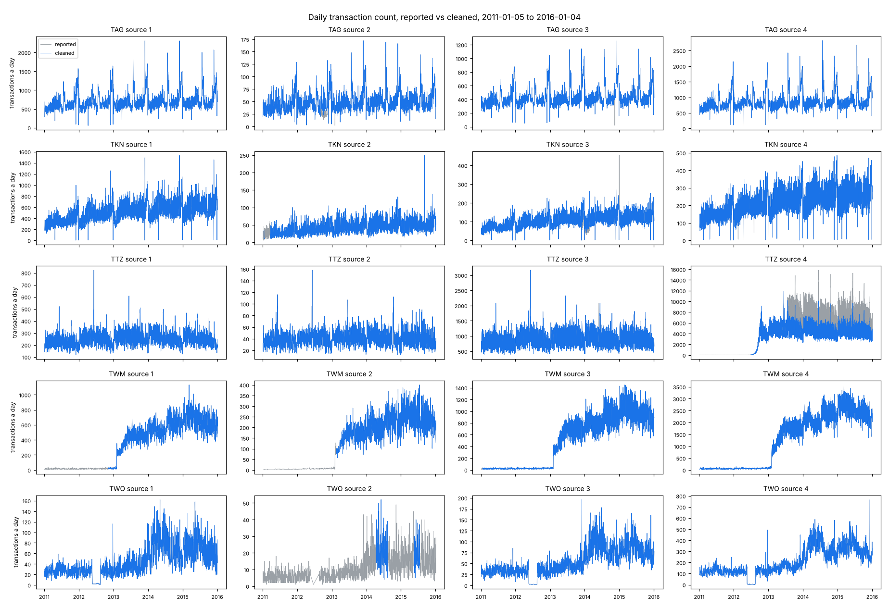

# Trust scores and cleaned series: method report

## Data

Daily transaction count (`ct`) and dollar total (`amt`) per company and source, 2011-01-05 to 2016-01-04: five
companies (TAG, TKN: Nordstrom stores and Rack; TTZ, TWM, TWO: three airlines), four sources each.

| Property (measured) | Value |
|---|---|
| Typical daily count per series (median) | 9 (TWO-2) to 5,528 (TTZ-4) |
| Weekday swing, busiest/quietest day | 1.3x (TWO) to 1.8x (TKN) |
| Series starting under 20 a day (28-day median) | TKN-2, TTZ-4, TWM-1, TWM-2, TWO-2 |
| Ticket size across one company's sources | within about 25% |

Limits: nothing records which days are wrong. A problem hitting two of four sources at once can pass as a company
move; one common to all four is always trusted.

## Method

Each source is compared with its three sisters in log count and log ticket (`amt`/`ct`): per pair, the day's log
difference minus the pair's weekday median over their first 112 established days; `rel` is the median over pairs.
Company-wide moves and weekday patterns cancel.

`sigma` = 1.4826 x MAD (median absolute deviation) of `rel` over the trailing 120 usable days, floored at 0.02,
widened by counting noise (1/expected count). `z = rel/sigma`.

| Rule | Detection | Treatment |
|---|---|---|
| Low signal | before a source holds a 28-day median of 20+ for 90 days, days under 20 (16 once kept) | distrusted, blank |
| Spike | abs(z) > 6, at most 3 days | distrusted; imputed as the sisters' move at the source's own level (42-day median) |
| Yearly pattern | same-sign spike within 3 days of the date 1 or 2 years earlier | trusted, kept |
| Level change | spike lasting more than 3 days, or CUSUM (allowance 1, alarm 12, z clipped at 4) confirmed by a 7-day median 2 sigmas off; not if it alarmed within 14 days of the date 1-2 years earlier | distrusted 14 days, then trusted; rescaled to the original level by the 14-day median offset until it falls under 1/3 of its peak |

CUSUM sums deviations beyond an allowance and alarms past a threshold. Imputed values follow the sisters' move that
day, so they keep the weekday and holiday pattern. A second pass uses the sisters' cleaned values. A source is judged after
56 usable days; without an anchored pair it is trusted. Every step uses trailing data only. Not
handled: drifts over months.

## Output

`confidence`: 1 trusted, 0.3 new level change, 0.05 spike, 0 low signal. `clean_ct`,
`clean_amt`: on the source's own basis; blank only for low signal. `reason` (ok, spike,
level_change, rescaled, yearly_pattern, low_signal); `adj_ct`, `adj_ticket`: log adjustment. Model on confidence
0.5+; never compare levels across sources.

## Parameters

| Parameter | Value | Rationale |
|---|---|---|
| Low-signal bar, drop bar, establishment | 20 a day, 16, 90 days | 20 given as the minimum; 16 and 90 tuned (hysteresis: less flicker, later start) |
| Warm-up, noise window | 56, 120 days | tuned: shorter reacts faster, noisier sigma |
| Anchor | 112 days | tuned: longer is steadier, later start |
| Spike bar, length | 6 sigmas, 3 days | tuned: lower catches more, adds false alerts |
| CUSUM allowance, alarm, clip | 1, 12, 4 | allowance 1 sigma standard; 12 and 4 tuned (lower alarms earlier, more false changes) |
| Confirmation | 2 sigmas, 7 days | tuned: filters bursts, delays detection |
| Distrust window, level median | 14 days, 14 | tuned: longer distrust costs history |
| Yearly slack | 3 / 14 days | holidays move by days across years |
| MAD scale, sigma floor | 1.4826, 0.02 | 1.4826 makes MAD a standard deviation; floor stops near-zero sigma |
| Imputation level window | 42 days (56 - 14) | tuned |
| Change end | 1/3 of peak | tuned: lower holds changes longer |
| Expected-count window | 28-day median, 7 days minimum | four weeks keeps weekday balance |
| Confidence values | 1, 0.3, 0.05, 0 | set: under 0.5 means distrust; lower is surer |
| Log floors | 0.5 transactions, $0.01 | avoid log of zero |

Tuned on practice panels with planted problems, one value at a time, for most problems caught per false alert.

## Validation

I planted 34 problems on established series and compared with the unplanted run.

| Planted | Caught | Error removed |
|---|---|---|
| 16 count spikes (x2.5-3) | 9 | 68% |
| 8 dropouts (x0.3-0.4) | 5 | 81% |
| 6 ticket spikes (x2.5) | 1 | 70% |
| 2 lasting changes (x0.6/1.6) | 1 | 77% |
| 2 90-day shifts | 2 | 88% |

34 of 56 alerts touched planted problems (unplanted panel: 20). A run cut at 60% matched the full run; a
rerun on its own output distrusted 97 rows against 101. Tuning used similar panels; these may flatter. It fails
when two sisters break together.

## Open issues

Blank (low signal): thin starts of TWM-1 (to 2012-11-06), TTZ-4 (to 2012-06-23), TKN-2 (to
2011-03-21) and TWM-3 (to 2011-01-19); TWO-2 almost throughout (2011-01-05 to 2016-01-04, gaps 2012-05 to 2012-08
and 2014-04 to 2014-08); TWM-2 in 2011-06 to 2013-02, in 21 runs of 5-62 days. One TTZ-2 level-change day (2014-10-15) is
left near the reported value. Treat these as missing. Small ticket spikes are often missed.
