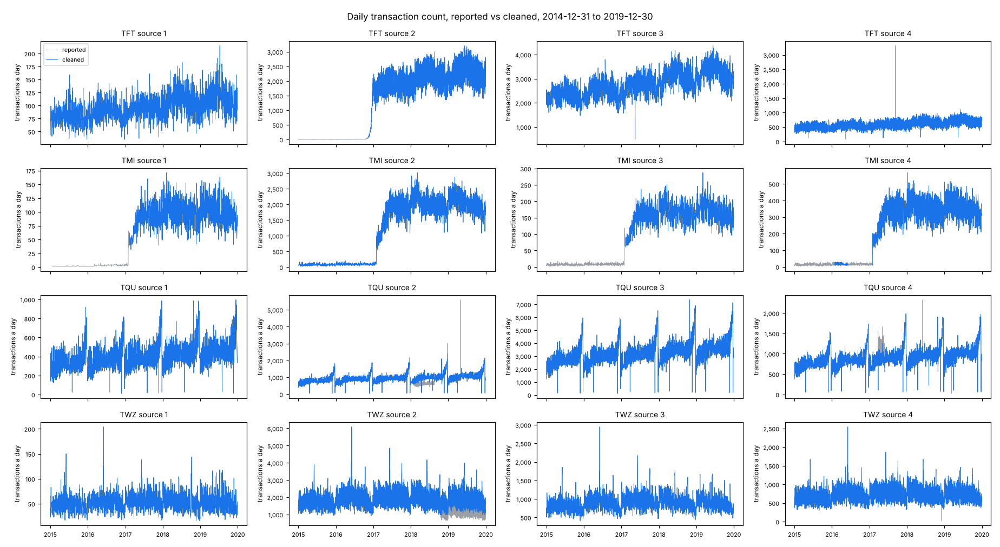
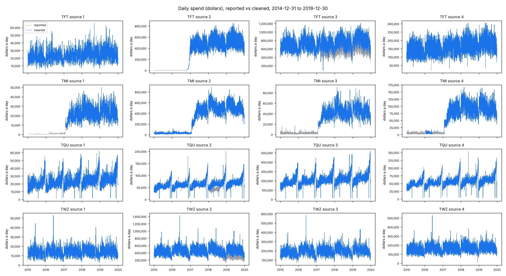

# Trust scores and cleaned series: method report

## Data

The panel gives each source's daily transaction count (`ct`) and dollar total (`amt`) for four companies from
2014-12-31 to 2019-12-30. Four sources report each company: United Airlines (TFT), American Airlines (TMI), T.J. Maxx
and Marshalls (TQU) and Southwest Airlines (TWZ).

A series is named by company and source: TMI-1 is TMI's source 1.

| Property (measured) | Value |
|---|---|
| Typical daily count per series (median) | 54 (TWZ-1) to 2,931 (TQU-3) |
| Weekday swing, busiest/quietest day | 1.4x (TQU) to 1.9x (TWZ) |
| Series starting under 20 a day (28-day median) | TFT-2, TMI-1, TMI-3, TMI-4 |
| All four TMI sources jump together | about tenfold, early 2017 |
| Average ticket | about $60 (TQU), $210-280 (airlines) |

Nothing records which days are wrong. A problem hitting two of four
sources at once can pass for a company move, and one shared by all four (TMI, 2017) cannot be told from one.
## Method

Each source is compared with its three sisters, in log count and in log ticket size (`amt`/`ct`). For each pair,
the day's log difference is compared with the pair's usual difference for that weekday over their first 112
established days. The median over pairs is the deviation, `rel`, from which company-wide moves and weekday patterns
cancel.

The noise, `sigma`, is 1.4826 times the median absolute deviation (MAD) of `rel` over the last 120 usable days,
floored at 0.02, and widened for counting noise to sqrt(sigma^2 + 1/expected count). The score is `z = rel / sigma`.

| Rule | Detection | Treatment |
|---|---|---|
| Low signal | before a source holds a 28-day median of 20+ for 90 days, days under 20 (16 once kept) | distrusted, blank |
| Spike | abs(z) > 6, at most 3 days | distrusted; imputed as the sisters' move at the source's own level (42-day median) |
| Yearly pattern | same-sign spike within 3 days of the date 1 or 2 years earlier | trusted, kept |
| Level change | spike lasting more than 3 days, or CUSUM (allowance 1, alarm 12, z clipped at 4) confirmed by a 7-day median 2 sigmas off; not if it alarmed within 14 days of the date 1-2 years earlier | distrusted 14 days, then trusted; rescaled to the original level by the 14-day median offset until it falls under 1/3 of its peak |
| Warm-up | first 56 usable days of a source; a source with no anchored pair | not judged; trusted as reported |

CUSUM adds up deviations beyond an allowance and alarms when the total passes a threshold. Imputed values follow the
sisters' move that day, so they keep the weekday and holiday pattern. A second pass repeats the comparison with the sisters'
cleaned values, so one source's problem does not distort its sisters' scores. Every step uses only past data, in trailing windows. Slow drifts are not handled.

## Output

| Column | Meaning |
|---|---|
| `confidence` | the probability that the day is fine, from its distance to the expected level in noise units; under 0.5 = distrust |
| `clean_ct`, `clean_amt` | the source's series on its own original basis; blank only for low signal |
| `reason` | ok, spike, level_change, rescaled, yearly_pattern or low_signal |
| `adj_ct`, `adj_ticket` | the log adjustment applied |
| How to use | model on rows with confidence of 0.5 or more; never compare levels across sources |

## Parameters

| Parameter | Value | Rationale |
|---|---|---|
| Low-signal bar, drop bar | 20, 16 transactions a day (28-day median) | 20 given as the minimum; 16 tuned (hysteresis: less flicker, later drop) |
| Establishment | 90 days | tuned: longer drops more early history |
| Warm-up, noise window | 56, 120 usable days | tuned: shorter reacts faster, noisier sigma |
| Anchor | 112 days | tuned: longer is steadier, later start |
| Spike bar, length | 6 sigmas, 3 days | tuned: lower catches more, adds false alerts |
| CUSUM allowance, alarm, clip | 1, 12, 4 sigmas | allowance 1 sigma standard; 12 and 4 tuned (lower alarms earlier, more false changes) |
| Confirmation | 2 sigmas, 7 days | tuned: filters bursts, delays detection |
| Distrust window, level median | 14 days, 14 days | tuned: longer distrust costs history |
| Yearly lookback, slack | 1 and 2 years; 3 days (spikes), 14 days (changes) | yearly seasonality; holidays move by days across years |
| MAD scale, sigma floor | 1.4826, 0.02 (log) | 1.4826 makes MAD a standard deviation; floor stops near-zero sigma |
| Imputation level window | 42 days (56 - 14) | tuned: longer is steadier, slower to follow growth |
| Change end | offset under 1/3 of its peak | tuned: lower holds changes longer |
| Expected-count window | 28-day median, 7 days minimum | four weeks keeps weekday balance |
| Confidence curve | logistic, 1.5 per sigma, crossing 0.5 at the spike bar | 0.5 given as the trust line; slope 1.5 tuned (1.0 scored the same) |
| Change build-up, inside a change | falls 0.8 per CUSUM unit past half the alarm (6); even odds at an offset of 1 sigma | tuned: the days before a change is confirmed score lower, so a late alarm costs less |
| Thin start | 0.45 times the 28-day median over 20 | keeps thin days under 0.5, lower when thinner |
| Log floors | 0.5 transactions, $0.01 | avoid log of zero |
| How "tuned" values were set | practice panels with planted problems, one value at a time | most problems caught per false alert |

## Validation

I planted 34 problems on established series.

| Planted | Caught | Error removed |
|---|---|---|
| 16 count spikes (x2.5-3) | 12 | 43% |
| 8 dropouts (x0.3-0.4) | 7 | 56% |
| 6 ticket spikes (x2.5) | 6 | 16% |
| 2 lasting changes (x0.6/1.6) | 2 | 67% |
| 2 90-day shifts | 2 | 90% |

Of the 42 alerts on the planted panel, 24 touched a planted problem; the other 18 compare with the 19 alerts raised on the unplanted panel, some of which may be real problems. There is no look-ahead: a run on the panel cut at 60% of its dates gave the same output, up to the cut, as the full run. Run again on its own cleaned output, the method distrusted 69 rows, against 89 on the original data. Tuning used similar panels, so these results may flatter. The method fails when two sisters break together.

## Open issues

The output leaves these stretches blank or unrepaired; treat them as missing.

| Series | Left blank or unrepaired | Why |
|---|---|---|
| TFT-2 | to 2016-11-05 | thin start |
| TMI-3 | to 2017-02-11 | thin start |
| TMI-4 | to 2016-01-27, and 2016-06-06 to 2017-01-24 | thin start |
| TMI-1 | 57 stretches from 2015-01 to 2017-02 (202 days; 15 last 5 to 27 days) | under 20 a day |
| TQU-2 | 2018-08-20 | level-change day left near the reported value |

The main remaining risk is repaired ticket sizes: only 16% of the planted ticket error was removed.
