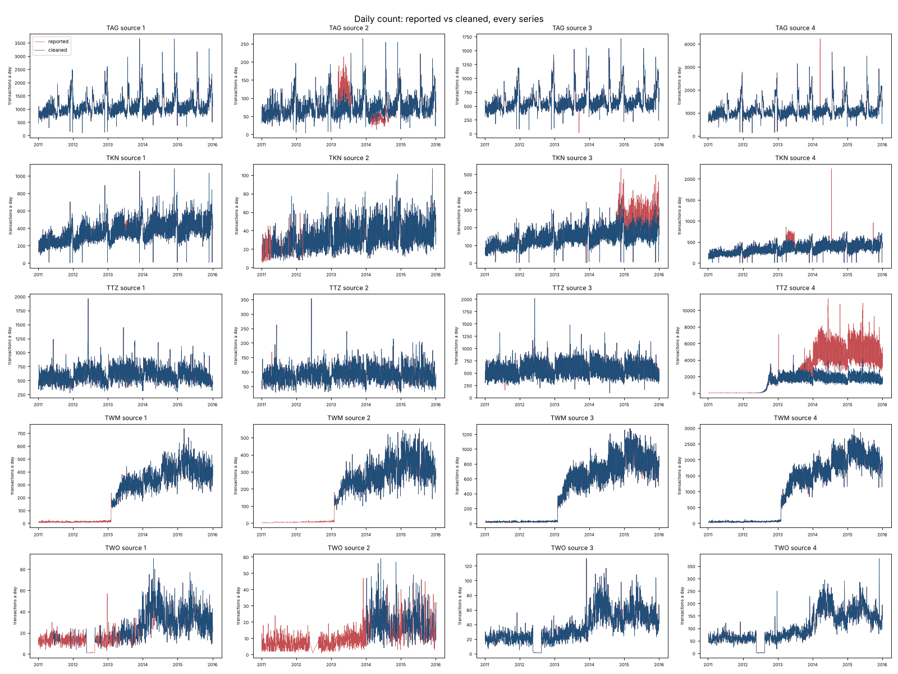

# Trust scores and cleaned series from sister-source gaps

## Data

Each row is one source's count of card transactions and their dollar total for one company on one day. The panel is daily from 2011-01-05 to 2016-01-04 and has 35,773 rows: five companies (TAG, TKN, TTZ, TWM, TWO), each read by four sources. Median daily counts run from 10 (TWO source 2) to 2,417 (TTZ source 4), and the busiest weekday carries about 1.7 times the quietest. The method has to deal with single-day errors, lasting level changes, dips that recur each year and thin early history. The data cannot show a fault shared by all four sources of a company: that would pass as a real move.

## Method

Count and ticket (dollars per transaction) are handled separately, in logs. A source's **gap** is the median, over its sisters, of today's difference from the sister minus the median of that difference on the same weekday over the trailing 52 weeks of cleaned values. A real move of the company or a weekday pattern cancels in that difference. Noise is the trailing-year spread of the gap, measured as 1.4826 times the median absolute deviation, which outliers barely move.

| Case | Rule | Treatment |
|---|---|---|
| Single day | gap more than 4 noise spreads from the level | imputed from the sisters |
| Level change | median gap of the last 7, 14 or 28 days beyond 4 of its own spreads | reported value minus that median |
| Yearly pattern | the same gap 364 to 366 days earlier | kept as reported |
| Thin start | 28-day median under 20 a day, before 90 days at 20 | blank |

The level uses the longest window that agrees with the last week. With one sister only, a day is imputed beyond 8 spreads; with none, rows are kept as reported. Confidence falls smoothly from 0.995 as the gap grows, and an imputed row scores 0.52 to 0.92. Every quantity uses trailing windows only.

## Output

`confidence` is the probability that the cleaned value is right. `clean_ct` and `clean_amt` are the cleaned count and dollars. `treatment` says what was done: as reported, imputed, rescaled, yearly pattern kept or discarded. A blank means the row was discarded as thin. Do not sum sources: they overlap.

## Parameters

| Number | Value | Why |
|---|---|---|
| Day threshold | 4 spreads | tuned: lower imputes ordinary days |
| Level threshold | 4 spreads | tuned: lower rescales noise |
| Agreement | 1.5 spreads | tuned: higher follows ramps late |
| One-sister factor | 2 | tuned on false imputations |
| Windows | 7, 14, 28 days; 52 weeks | whole weeks; one year |
| Noise floor, default | 0.02, 0.15 | guard before 30 observations |
| Thin line | 20 a day, 90 days, 0.8 edge | given; edge tuned |
| Yearly share | 0.5 | tuned |

## Validation

After the first year, 43 rows are imputed, 1,837 rescaled and 7 kept as yearly patterns. Truncating the panel at 2014-06-30 changed none of the 24,719 earlier rows. Re-run on its own cleaned output, the code imputed 20 rows and rescaled 60. It would fail where two sources of a company go wrong together.

## Open issues

Rows distrusted and left blank, 3,649 in all:

| Series | Dates | Rows |
|---|---|---|
| TKN 2 | 2011-01-05 to 2012-03-12 | 107 |
| TTZ 4 | 2011-01-05 to 2012-06-09 | 487 |
| TWM 1 | 2011-01-05 to 2013-02-06 | 756 |
| TWM 2 | 2011-01-08 to 2013-02-06 | 340 |
| TWM 3 | 2011-01-05 to 2012-01-11 | 70 |
| TWO 1 | 2011-01-05 to 2013-12-21 | 680 |
| TWO 2 | 2011-01-05 to 2015-12-31 | 1,209 |

Each is under twenty transactions a day; use the company's other sources there. TTZ source 4 is divided by 2.8 from 2013-08-15 and TKN source 3 by 1.45 from 2014-10-24, both to the end: confirm these with the provider.

