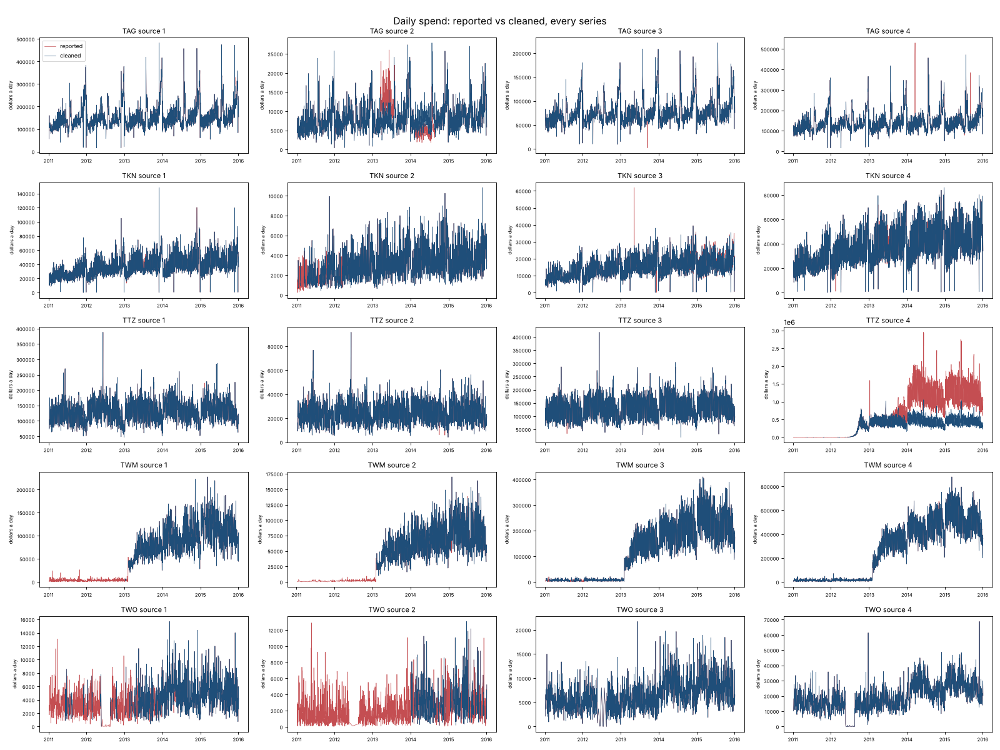

# Trust scores and cleaned series from sister-source gaps

## Data

Each row is one source's count of card transactions and their dollar total for one company on one day. The panel is daily from 2011-01-05 to 2016-01-04 and has 35,773 rows: five companies (TAG, TKN, TTZ, TWM, TWO), each read by four sources. Median daily counts run from 10 (TWO source 2) to 2,417 (TTZ source 4), and the busiest weekday carries about 1.7 times the quietest. The data cannot show a fault shared by all four sources of a company: it would pass as a real move and be trusted.

## Method

Count and ticket (dollars per transaction) are treated separately, in logs. For each sister, the code takes today's difference between source and sister, and subtracts the median of that difference on the same weekday over the trailing 52 weeks of cleaned values. The source's **gap** is the median of these over its sisters. A company's real move and each weekday pattern cancel in the difference. The **spread** is the gap's usual size: 1.4826 times its median absolute deviation over the trailing 365 days, a standard deviation that outliers barely move. The **level** is the median gap of the last 28 days, or of the last 14 or 7 when the longer window is more than 1.5 spreads from the last week.

| Problem | Rule | Cleaned value |
|---|---|---|
| One to three days too high or low | gap minus level beyond 4 spreads | reported minus gap: the sisters' value today at the usual relation, so weekday and holiday come from the sisters |
| Step, ramp, slow drift, temporary shift | level beyond 4 spreads of such a median | reported minus level, keeping the source's own daily noise; ends when the level returns |
| Yearly dip | same sign, at least half the gap, 364 to 366 days earlier | as reported |
| Thin start | 28-day median under 20 and 7-day median under 16, before 90 days running at 20 | blank |
| Not caught | all sources wrong together; changes under 4 spreads | as reported |

Cleaned values stay on the source's own usual level. A step's first three days are imputed, because the 7-day median has not yet moved.

| Row | Confidence, z = distance in spreads |
|---|---|
| As reported | 0.995 − 0.005·min(z, 2)/2 − 0.22·clip((z − 2)/2, 0, 1) |
| Imputed | 0.52 + 0.40·clip((z − 4)/4, 0, 1); one sister: 0.51 + 0.1·(that − 0.52) |
| Rescaled | 0.97 (0.90 on 7- or 14-day level) − 0.15·clip(z/4, 0, 1) |
| Yearly | 0.80 − 0.05·clip(z/16, 0, 1) |
| No sister / blank | 0.97 / 0.05 |

A row takes the lower of its count and ticket confidence. Every window is trailing, so a day's output uses only that day and earlier ones.

| Where a rule cannot apply | What happens |
|---|---|
| Under 3 same-weekday weeks | last 21 days, any weekday, at least 7 |
| Under 30 gaps | spread 0.15 |
| Level medians | need 4, 8 and 14 days |
| One sister, or several sources off | impute beyond 8 spreads |
| No sister | as reported |

## Output

| Column | Meaning |
|---|---|
| `confidence` | 0 to 1: probability the cleaned value is right; 0.5 or more means trust, below means do not |
| `clean_ct`, `clean_amt` | cleaned count and dollars |
| `treatment` | as reported, imputed, rescaled, yearly pattern kept, or discarded |

A blank is a discarded thin row. Keep rows at 0.5 or above and weight them by confidence. Each cleaned series is comparable with its own history, not with another source's level. Do not sum sources: they overlap.

## Parameters

Tuned values were set on separate panels of the same kind with known planted problems, not on this panel.

| Number | Value | Basis and trade-off |
|---|---|---|
| Day and level thresholds | 4 spreads | tuned: lower repairs ordinary days, higher misses small problems |
| Agreement | 1.5 spreads | tuned: higher follows ramps late, lower makes the level jumpy |
| One-sister factor | 2 | tuned: lower imputes the wrong source, higher misses problems |
| Windows | 7, 14, 28 days; 52 weeks; 365 days | whole weeks and one year: longer is steadier but slower |
| Minimum days in a level median | 4, 8, 14 | over half the window, so one missing week cannot set the level; lower is noisier |
| Spread floor; default; minimum history | 0.02; 0.15; 30 gaps | guards: lower floors flag rounding |
| Counting floor | 1/√(28-day median count) | standard: the relative error of a count of that size; without it small sources are over-flagged |
| Level-spread defaults; floors | 0.6, 0.5, 0.4; 0.4, 0.32, 0.25 of the spread | near 1/√n for a median; lower rescales noise |
| Spread refresh | every 7 days | speed only |
| Deviation scale | 1.4826 | standard for normal noise |
| Thin line; days; edge | 20; 90; 0.8 | given; edge tuned: higher blanks growing sources |
| Yearly share; lookback | 0.5; 364 to 366 days | tuned: higher imputes real dips; leap years |
| Confidence constants | 0.995, 0.005, 0.22, 0.52, 0.40, 0.51, 0.1, 0.97, 0.90, 0.15, 0.80, 0.05 | tuned on those panels so each treatment's confidence matches the share of its cleaned values that were right; higher overstates trust in repairs |

## Validation

On this panel I planted 48 one-day problems and 24 sixty-day steps on the 12 untreated series and compared cleaned values with the original data.

| Planted | Treated | Error removed |
|---|---|---|
| One day, sources of 100+ a day (31) | 100% | 94% |
| One day, smaller sources (17) | 59% | 78% |
| Steps, 100+ a day (18) | 92% of days | 76% |
| Steps, smaller sources (6) | 73% of days | 58% |

Only 0.2% of the rows far from a planted problem moved by more than 5%. Truncating the panel at 2014-06-30 changed none of the 24,719 earlier rows. Re-run on its own cleaned output, the code imputed 20 rows and rescaled 60 after the first year. The method is weakest on small sources and on steps that change only the count by about half. It fails when two sources go wrong together.

## Open issues

Rows distrusted and left blank, 3,649 in all, each under twenty transactions a day; use the company's other sources there.

| Series | Dates | Rows |
|---|---|---|
| TKN 2 | 2011-01-05 to 2012-03-12 | 107 |
| TTZ 4 | 2011-01-05 to 2012-06-09 | 487 |
| TWM 1 | 2011-01-05 to 2013-02-06 | 756 |
| TWM 2 | 2011-01-08 to 2013-02-06 | 340 |
| TWM 3 | 2011-01-05 to 2012-01-11 | 70 |
| TWO 1 | 2011-01-05 to 2013-12-21 | 680 |
| TWO 2 | 2011-01-05 to 2015-12-31 | 1,209 |

No row is distrusted and left at its reported value. The level rule rescales TTZ source 4 from 2013-08-15 and TKN source 3 from 2014-10-24 through the last day; ask the provider whether those changes are real coverage gains.

